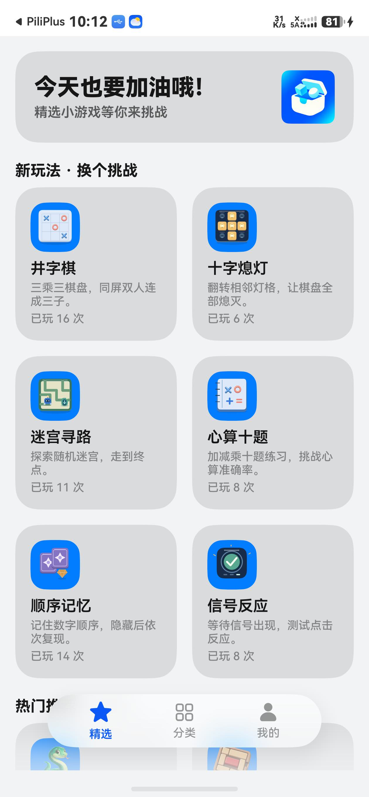
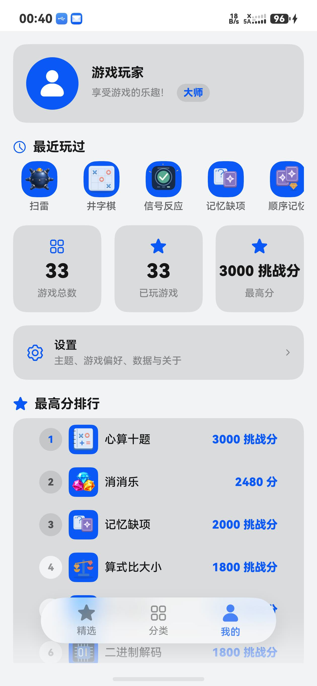
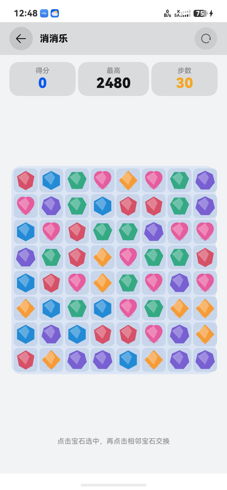

# 玩趣盒

### 六大分类，79 款单人小游戏，随手开一局。

基于 HarmonyOS NEXT 的原生单人小游戏合集，采用蓝青色游戏盒子图标。打开即玩，战绩留在本机。中国象棋与国际象棋保留离线电脑对战。

项目仓库名为 LittleGames，应用名称为「玩趣盒」。

**ArkTS / ArkUI** · **HarmonyOS API 26，最低兼容 API 24** · **手机 / 平板工程配置**

---

## 界面预览

  
  
  

精选推荐 · 个人战绩 · 沉浸游玩｜2026-10-02 Mate 60 Pro 历史版本真机实拍

## 玩什么

| 分类 | 数量 | 游戏 |
| --- | ---: | --- |
| 街机休闲 | 18 | 贪吃蛇、俄罗斯方块、打砖块、泡泡龙、落果合成、黑洞吞噬、大鱼吃小鱼、房间塔防、迷你餐厅、滚动球闯关、雷电战机、坦克对战、射击守城、自动攻击生存、台球、保龄球、爬坡越野、休闲钓鱼 |
| 逻辑解谜 | 28 | 扫雷、滑动拼图、华容道、消消乐、十字熄灯、色块归一、迷宫寻路、汉诺塔、跳子独留、数字绘格、方块拼填、堆叠三消、倒水排序、箭头清除、拆螺丝、停车场挪车、推箱子、管道连通、连连看、麻将接龙、点击群消、落槽配对消除、乘客上车、毛线收卷、沙画吸色、绳结解开、画线救援、图片拼图 |
| 棋盘对弈 | 5 | 经典纸牌、中国象棋、国际象棋、蜘蛛纸牌、空当接龙 |
| 数字训练 | 8 | 2048、数独、猜数字、心算十题、算式比大小、数列推演、二进制解码、补数求和 |
| 记忆专注 | 5 | 记忆翻牌、数字寻序、顺序记忆、记忆缺项、旋律记忆 |
| 反应节奏 | 15 | 打地鼠、跳一跳、信号反应、无尽跑酷、篮球投篮、节奏落键、横版跳跃闯关、钩索摆荡、飞行穿柱、切水果、足球点球、乒乓球、单键漂移、空气曲棍球、节拍跳跃 |

2026-10-19 在单人版本基础上再撤下隐藏物品、迷你农场、家居装饰、汉字拆组、成语填字、文字合成塔防、背包战斗、找不同、一笔画、迷你高尔夫，当前开放 79 款，原模型、资源与旧战绩保留。理由见[游戏去留审阅](docs/game-retirement-review-2026-10-19.md)。2026-10-12 撤下 11 款多人或多人棋牌玩法、保留 89 款的历史范围见[单人版本范围](docs/single-player-scope-2026-10-12.md)。原有[扩充记录](docs/game-expansion-2026-09-27.md)、[100 款工作清单](docs/game-expansion-100/plan.md)与[验证记录](docs/game-expansion-100/verification.md)作为历史开发证据保留，其中的数量和多人能力不代表当前产品范围。

## 体验细节

- **单人游玩**：当前目录提供 79 款本机单人游戏，不提供同屏多人或局域网房间入口。
- **离线电脑对战**：中国象棋与国际象棋保留玩家身份、电脑回合和三档策略，支持暂停、悔棋和对局接续。电脑对手的开发及历史检查见[人机实现记录](docs/computer-opponents.md)，其中已撤下游戏不属于当前目录。
- **每日精选**：每日寄语按本地日期轮换，内置 32 条祝福并可持续扩充；每日推荐覆盖当前游戏目录，点击“换一批”更换六款游戏，同一天重启后保留当前批次。分类页支持分类筛选，以及按名称或描述实时搜索。
- **本地续玩**：数独和 2048 自动保存未完成的对局；再次进入时可选择继续或新开一局，保留棋盘、难度和本局进度。
- **桌面卡片**：提供 2×2 今日推荐和 2×4 续玩卡片；续玩卡片显示 2048、数独的存档状态，点击直接恢复本地对局。
- **成绩分享**：结算页可生成仅含游戏名与结果的图片并打开系统分享；API 26 接入碰一碰坐标选择当前成绩区域，真实两机传输仍待设备验收。
- **API 26 光感**：游戏、设置及历史页使用原生标题栏材质和圆形操作按钮，设置 Sheet 与原生控件启用系统光感；API 24 保留兼容样式。
- **战绩自动保存**：最高分、累计游玩时长、最近玩过顺序、完整游玩历史和用户设置通过 Preferences 保存在本机；“我的”区分游戏总数与已玩游戏数。已撤下游戏的旧记录保留在本机，不再显示或计入当前合集统计。
- **二级设置菜单**：从“我的 → 设置”调整跟随系统 / 浅色 / 深色主题、震动反馈、默认难度、各游戏难度记忆和退出对局确认。偏好重启后保留；默认难度在下次进入支持难度的游戏时生效。
- **数据与关于**：恢复默认设置保留战绩及未完成对局；清空游玩数据同时删除战绩和本地对局存档，保留偏好，两项操作都需要确认。关于页面提供软件声明、本地数据与权限说明、使用帮助，版本号读取当前安装包。
- **界面随主题变化**：页面使用 HarmonyOS 系统色与统一间距，适配浅色和深色模式；可点击控件提供按压反馈。
- **美术与互动**：当前 79 款沿用各自入口素材、场景、角色、道具和棋具，并提供浅深色主题资源；加入选中回弹、得分飘字、星点、失误提示和通关庆祝。素材开发过程及历史验证范围见[美术补全记录](docs/art/expansion-art.md)。
- **对局操作一致**：游戏页复用标题栏、方向控制、结算与退出确认组件。部分游戏提供简单、普通、困难难度。
- **语言与设备**：提供简体中文、英文字符串资源；工程声明支持 phone 和 tablet。
- **游戏区适配**：主要棋盘根据页面可用宽高调整尺寸；结算内容使用实体卡片，提高可读性。

## 运行项目

### 在 DevEco Studio 中

1. 安装 **DevEco Studio 26.0.0.851 Release（API 26）**。工程最低兼容版本仍为 **6.1.1（API 24）**；旧版 DevEco Studio 6.1.1 内置 SDK 不能用于当前工程的 API 26 构建。
2. 打开本仓库根目录，等待工程同步完成。
3. 启动 Local Emulator，或连接 HarmonyOS NEXT 真机。
4. 选择设备，点击 **Run**。真机运行前需在 DevEco Studio 中配置签名。

### 命令行构建（Windows PowerShell）

仓库根目录没有 hvigorw。构建入口默认使用 `C:/Program Files/Huawei/DevEco Studio` 中的 API 26 Node、SDK、Hvigor、ohpm 和 JBR，构建环境仅作用于子进程。本机已升级为 26.0.0.851，内置 JBR 为 25.0.2；图形版和命令行签名 HAP 构建均已通过。

~~~powershell
node scripts/build-hap.cjs
# Release 编译模式（正式分发还需相应发布签名与验收）
node scripts/build-hap.cjs release
~~~

独立 Command Line Tools 可通过 `LITTLEGAMES_TOOLCHAIN_ROOT` 指定到 `command-line-tools` 目录；本机原工具包仍保留于 `.local-tools/harmonyos-26.0.0.851/command-line-tools/`。其他兼容 JDK 可通过 `JAVA_HOME` 指定。默认配置为 compile/target=`26.0.0`、compatible=`6.1.1(24)`，并将高于最低兼容版本的 API 调用作为编译错误处理。图形版升级和 API 变更助手结果见[IDE 验收记录](docs/device-acceptance/api26-upgrade-2026-10-18/ide/REPORT.md)。

构建产物位于 **entry/build/default/outputs/default/**。仓库共享配置不包含个人签名材料，默认生成 unsigned HAP；在 DevEco Studio 中配置本机调试签名后可生成 signed HAP 并安装到真机。验收使用的签名配置仅保存在测试电脑，不提交证书、私钥或口令。

### 桌面逻辑回归

在项目根目录运行完整单人版本回归：

~~~powershell
node scripts/run-regressions.cjs
~~~

运行器依次执行现有检查，默认输出保存在 `entry/build/iteration-20261013/regressions/`，也可单独运行对应脚本。用 `ARKTS_TYPESCRIPT_PATH` 指向所用工具链的 `ohpm/node_modules/typescript/lib/typescript.js`，可选择对应 TypeScript 模块；用 `LITTLEGAMES_REGRESSION_OUTPUT` 指定其他证据目录。测试直接运行转换后的 Model / ViewModel，替代原生服务与时钟；ArkTS 编译、设备渲染和性能需分别验证。API 26 迁移记录见[升级实施记录](docs/api26-upgrade-implementation-2026-10-18.md)。

## 工程结构

~~~text
AppScope/                     应用信息与图标
entry/src/main/
├── ets/
│   ├── common/               设计令牌、游戏常量、通用工具
│   ├── components/           游戏页共用组件
│   ├── model/                游戏列表与本地数据
│   ├── pages/
│   │   ├── home/             精选、分类、我的
│   │   ├── classic/          原有街机与休闲页面
│   │   ├── puzzle/           原有益智游戏页面
│   │   ├── collection/       扩充玩法共用页面与各类棋盘
│   │   └── settings/         设置与关于页面
│   └── router/               页面路由
└── resources/                浅色、深色及多语言资源
docs/screenshots/             模拟器与真机界面截图
docs/device-acceptance/       真机验收报告与原始证据
docs/logic-audit-2026-10-02/  生成逻辑与难度审计记录
scripts/                     回归、素材生成及设备验收工具
~~~

主模块采用 **@ComponentV2**、**@Local**、**Navigation / NavPathStack** 和 **GridRow**；运行时没有第三方依赖。单人版本仅保留振动权限，撤下 `INTERNET` 与 `GET_NETWORK_INFO` 网络权限。

## 验证情况

**2026-10-13 游戏音效：** 当时 89 款上架游戏已接入操作、得分和结算声音，提供 182 个原创合成 WAV 资源，沿用音效设置和前后台生命周期。2026-10-19 撤下 10 款后仍保留其已有资源，当前 79 款继续使用原音效。资源说明、生成入口和格式清单见[游戏音效](docs/game-sounds.md)。2026-10-13 音效专项 12/12、相关桌面回归及 API 24 原生构建通过；声音听感、系统音量和蓝牙输出尚未做真机试听。

**2026-10-13 功能迭代：24 套、1307/1307 项桌面回归及 API 24 原生构建通过。** 独立手机模拟器完成每日推荐换批与重启保留、画线救援通关/失败/重开，以及数独和 2048 关闭进程后的本地续玩检查。当前为 Debug 开发测试包，完整玩法和发布专项继续按验收清单推进。修改内容、包身份及原始证据见[功能迭代记录](docs/feature-iteration-2026-10-13.md)。

**2026-10-12 单人版本范围调整：21 套、1267/1267 项桌面回归通过**，其中下架与旧数据保留专项 17/17，验证目录、分类数量、历史过滤、路由与旧接续拒绝，以及两款棋类三档电脑应答。应用入口依赖图不再触达联机模块或 NetworkKit，模块仅保留振动权限。部分检查覆盖保留的已撤下游戏底层模型；旧联机集成和传输套件不属于产品验证。详见[当次验证快照](docs/single-player-validation-2026-10-12.json)。该快照未记录原生构建或设备复验；后续功能迭代另行记录。

以下数字均对应历史版本，不作为 2026-10-12 范围调整后的原生构建或真机通过声明。签名包与当前源码、资源的对应关系，需用本轮构建和包哈希确认。

**2026-10-08 的 100 款基线**记录了 DevEco / API 24 构建成功，以及 **22 套、1305/1305 项桌面检查通过**，覆盖规则、完整目标路径、接续、AI、状态刷新和局域网协议等。测试执行转换后的 Model / ViewModel，不模拟 ArkUI 原生绘制。详见[历史逻辑审计](docs/logic-audit-2026-10-08/README.md)与[验证快照](docs/logic-audit-2026-10-08/verification.json)。

**2026-10-08—09 的 e14b3364… 基线包**完成 100 款真实入口、标题、截图与返回检查，并记录 16 项浅深色通用 UI 检查；另有 9 款实时游戏及贪吃蛇、俄罗斯方块、打地鼠的选定操作、暂停/恢复或重开检查。打砖块专项记录仍未完成。该轮不代表 100 款完整目标、全部难度或长局性能通过。范围见[入口记录](docs/device-acceptance/final-2026-10-08/catalog.json)、[通用 UI 记录](docs/device-acceptance/final-2026-10-08/summary.json)、[实时专项](docs/device-acceptance/final-2026-10-08/worlds.json)、[经典专项](docs/device-acceptance/final-2026-10-08/classics.json)及[动态截图补充复核](docs/device-acceptance/final-2026-10-08/manual-review-bubbles-fruit.md)。

**2026-10-02 Mate 60 Pro（ALN-AL00）历史真机记录覆盖 33 款游戏、58 组选定用例**，包括多款解谜游戏完整通关、三档难度生成、实时游戏操作、暂停与后台恢复，以及迷宫切难度后的渲染修复。先前已完成 33 款浅色/深色入口与返回、设置持久化和结算弹窗复测；各轮对应不同测试包，以报告中的哈希和实际操作范围为准。详见[历史玩法验收](docs/device-acceptance/generation-audit-2026-10-02.md)与[设备验收索引](docs/device-acceptance/README.md)。

**WEB-W00 平板历史版本已完成横屏、竖屏各 33 款入口与返回检查**，并实测系统悬浮窗和不同高度的分屏。已修复打地鼠洞位越界、精选页在高窗口中居中，以及 8 款游戏在矮窗口中棋盘裁切或与操作区重叠的问题；该轮最终包复测矮分屏 11 款、横屏修改页 9 款，带进度真实旋转、锁屏恢复、悬浮窗挡板拖动和结算重开均通过。复测范围、实际输入和各测试包身份见[平板窗口验收](docs/device-acceptance/tablet-window-2026-10-02/README.md)。

原有 13 款的 API 24 手机与 Mate X7 展开态模拟器结果保留在[历史回归记录](docs/emulator-review-2026-09-25.md)。**长局帧率、内存、温升耗电、英文与最大系统字体、无障碍、折叠切换、真实跨设备接续和 Release 包专项仍待验收**；现有记录不代表所有随机局、所有胜负路径或所有机型通过。

2026-10-02 更新为游戏盒子品牌图，桌面图标、系统启动窗口、首页和关于页已通过真机复测。当前启动窗口仅显示图标，不叠加应用内启动页；历史截图可能保留旧图标。素材来源与提示词见[品牌素材记录](docs/art/brand-game-box/README.md)，实测见[图标验收](docs/device-acceptance/brand-game-box-2026-10-02/README.md)。

---

**挑一款，开始玩吧。**

## 鸿蒙应用接续与沉浸光感

当前保留游戏沿用对局接续与 HDS 原生悬浮页签材质，最低 API 24；活动中的实时对局恢复后先暂停，信号反应恢复到准备状态。实现说明、官方资料与历史验证步骤见[接续与沉浸光感说明](docs/harmonyos-continuation-immersive-light.md)。

API 26 桌面卡片、原生标题栏／设置光感和成绩分享的实现及实际模拟器证据见[功能验收记录](docs/device-acceptance/api26-features-2026-10-18/REPORT.md)。

历史接续桌面回归与设备玩法检查按各自报告范围保留；当前单人版本需重新验证，真实系统跨设备接续及沉浸材质效果仍需专项验收。最初扩充过程保留在[游戏扩充记录](docs/game-expansion-2026-09-27.md)。
