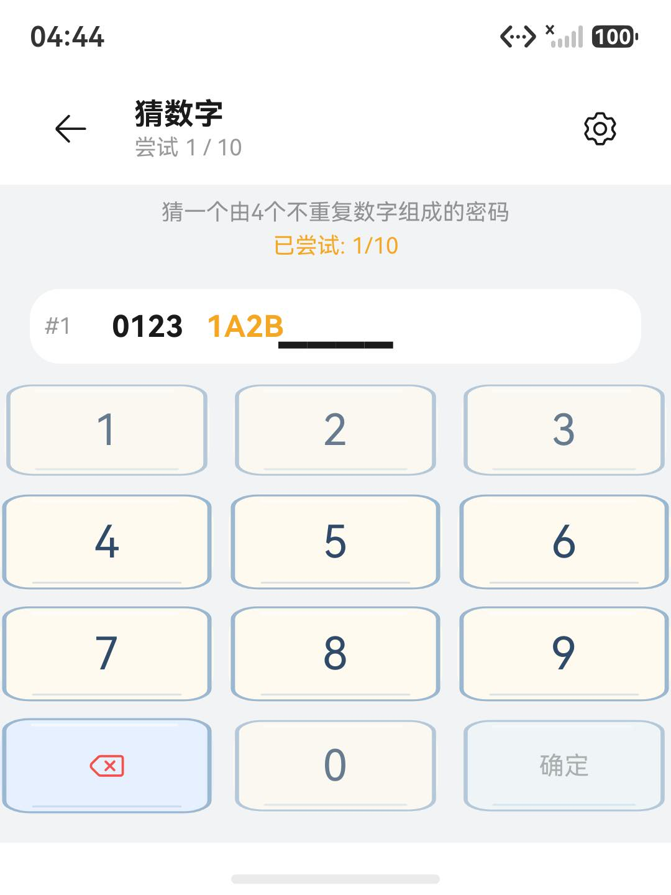
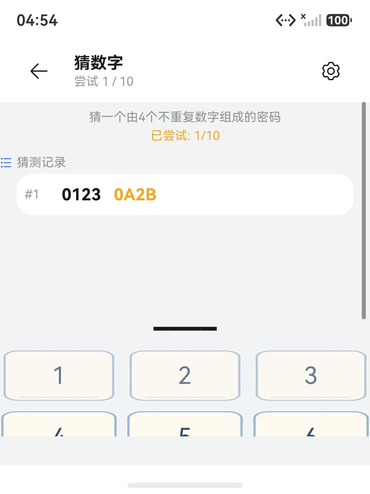
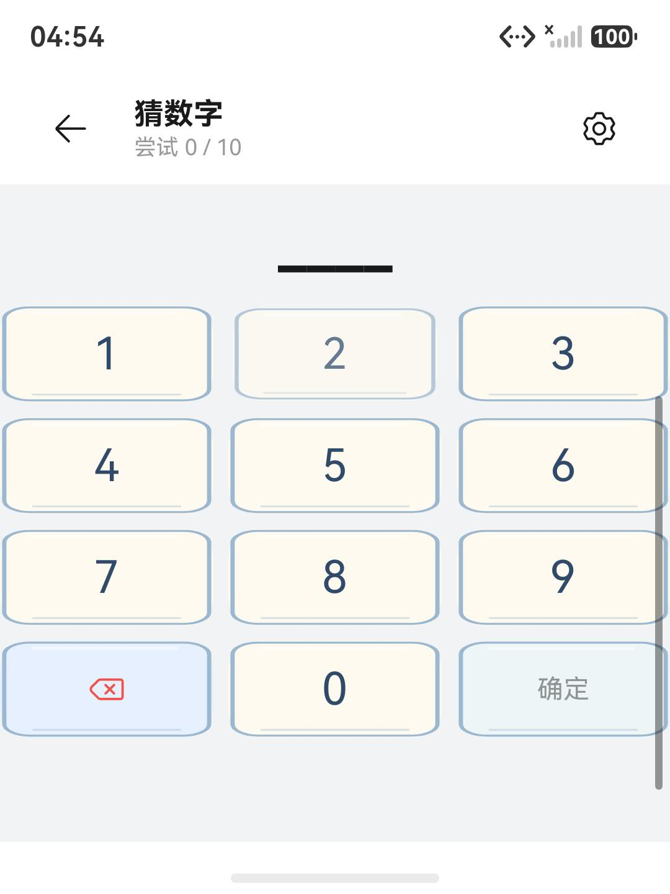

# API 26 升级模拟器验收

日期：2026-10-18，Asia/Shanghai。此记录为官方本地模拟器的选定场景验收，不是手机真机或全 89 款游戏三次结算报告。

## 结论与候选包

compile / target 为 `26.0.0`，compatible 保持 `6.1.1(24)`。API 24 与 API 26 均能安装运行。短屏实测发现猜数字记录区与输入位置重叠，已修复并以阶段 C 重测。最终 Debug / Release 原生构建成功，桌面 26 套回归 1340/1340，API 兼容性专项结果 `[]`、直接 CLI 退出码 0。

最终模拟器实际安装 `stage-c-unsigned.hap`，SHA-256：

```text
7fa619fc3768e05bcf0459117958971d55ae079dd989ba80b26e2033883114d4
```

包内 SDK 为 `26.0.0.105`，minAPIVersion=`60101024`，targetAPIVersion=`260000026`，包名 `com.littlegames.collection`，版本 `1.0.0 / 1000000`。三个最终证据目录均保存 `device-package.json` 与 `installed-bundle.txt`，区分实际系统与包内目标版本。

| 实例 | HDC 目标 | 实测系统 | 屏幕 |
| --- | --- | --- | --- |
| LittleGamesApi24Upgrade | 127.0.0.1:15524 | API 24，emulator 6.1.0.126(SP1DEVC00E120R4P11) | 1080×2340，480 dpi |
| LittleGamesApi26Upgrade | 127.0.0.1:15526 | API 26，emulator 7.0.0.107(SP8DEVC00E999R4P11) | 1080×2340，480 dpi |
| LittleGamesApi26Compact | 127.0.0.1:15527 | 同上 API 26 | 1080×1440，480 dpi，即 360×480vp |

短屏实例用于降低可用高度的布局验证，没有模拟真实分屏、自由窗口拖动或折叠设备形态变化。

## 实际执行的场景

| 候选 / 系统 | 已观察结果 | 证据 |
| --- | --- | --- |
| A → B，API 24 | 通过界面建立 2048 和数独进度后覆盖安装；棋盘逐格值一致，保留 2048 分数 20、深色主题、历史与最高分 | `seed-api24-*.json`、`api24-target24-baseline/`、`api24-target26/` |
| B → 最终 C，API 24 | 再次覆盖安装，两款存档逐格值仍一致；新布局下猜数字可输入及提交 | `api24-target26-final/` |
| B，API 24 / 26 | 两系统方向面板中央圆点和箭头正常；方向输入后实际移动，手动暂停，后台停留再返回，蛇身/食物图像位置一致，设置仍为“继续”；恢复后自然撞墙，显示结算 | 两系统 `snake-controls`、`snake-manual-paused`、`snake-paused-background-return`、`snake-manual-pause-retained`、`snake-natural-result` |
| B，API 26 | 浅色首页 HDS、图标、猜数字四位输入与提交、后台返回、设置面板、系统重开确认与取消、自绘自然结算；深色首页与游戏 | `api26-target26/` 中对应命名截图 / UI 树 |
| 最终 C，API 26 | 深色与系统“特大”字号条件下冷启动、首页、猜数字提交；连续七条真实猜测后，滚动显示最早 #1 / 0123 及 A/B 提示；系统重开取消和自然结算 | `api26-target26-final/` |
| 最终 C，API 26 短屏 | 固定标题，滚动查看历史与完整键盘；实际输入并提交 0123；回滚可见 #1 / 0123 / 0A2B，记录与输入不再重叠；设置面板可返回游戏 | `api26-compact-target26-final/` |

每个目录的 `actions.jsonl` 记录时间、HDC 目标、包散列和采样文本。桌面回归、模拟器结算和此前真机验收的计数互不合并。

API 24 的阶段 A 基线仍使用 API 26 编译，但 target=24；它不是升级前原始 API 24 编译的发布包。覆盖安装过程中没有卸载、清数据或直接修改应用存储。最终 C 存档比较仍以阶段 A 的可见棋盘值为基准。

## 短屏问题与修复证据

修复前，固定键盘挤压历史布局，首条卡片与输入下划线占据相同区域：



`GuessNumberPage` 增加原生 Scroll 和资源化的最小内容高度，列表按可用空间分配高度并保留记录上限。保留原按键大小；短屏通过滚动访问内容，普通高度继续使用剩余空间展示历史。





普通高度额外执行七条记录滚动验收，避免仅修复短屏却丢失早期线索。旧桌面用例解析固定 `.height(...)` 源码；现改为验证历史数据保留，把实际滚动、裁切交给本轮 UI 证据。

## 字号、主题与边界

在系统设置“显示和亮度 → 字体大小和界面缩放”将字号从“标准”（滑块 2）改为“特大”（滑块 5），保留前后截图，并在该条件下检查深色页面、系统确认框及冷启动。没有修改字体粗细、显示缩放或进入关怀模式。本项不等于完成读屏及所有字体倍率的无障碍审计。

字号设置证据在 `api26-system/font-before.*`、`font-large-applied.*`、`font-restored.*`，应用对应场景在阶段 B / C 的大字号截图。验收后恢复标准字号及应用原“跟随系统”主题，已正常关闭本次三个独立模拟器，保留实例数据和证据。

以下范围尚不能给出通过结论：

- 真机声音听感、振动、帧率、内存、耗电、长时间后台和机型差异；本次仅观察到模拟器系统音频链路日志。
- 89 款游戏逐款三次结算、全部图标 / 棋盘、平板与折叠设备验收、真实跨设备接续。
- 商店发布签名与审核。Release 表示编译模式，本机 Profile 仍为 debug，不能据此认定可提交上架。

构建保留 13 条原有或新版 SDK 能力告警，没有版本兼容错误。详见[实施记录](../../api26-upgrade-implementation-2026-10-18.md)。

## 环境与可复查材料

华为 SDK / 软件服务协议由用户明确同意。镜像元数据已核实为 7.0.0.107 Release；工具、镜像和独立实例位于 `.local-tools/`。模拟器验收阶段保留旧 IDE 和原模拟器实例；后续图形版已升级为 26.0.0.851，IDE 同步、签名构建及 API 变更助手扫描见[IDE 续验记录](ide/REPORT.md)。HDC 使用独立端口 18710；没有修改系统虚拟化、安全或防火墙设置。

构建、包内元数据、最终 API 兼容性报告及回归报告位于 `.local-tools/api26-verification/`，关键文件为：

- `stage-c-build.*`、`stage-c-release-build.*`、`stage-c*-package.json` 与对应 HAP。
- `regressions-final/verification.json`、逐套日志。
- `api-compatibility-final.json`、`api-compatibility-final-exit.txt`、扫描日志。

官方 CodeLinter bat 包装器固定返回 1；最终扫描直接调用包内 Node 与 `codelinter/index.js`，实测退出码 0。扫描范围仅为 API 兼容性，不是全部 lint 或 GUI API Change Assistant。
