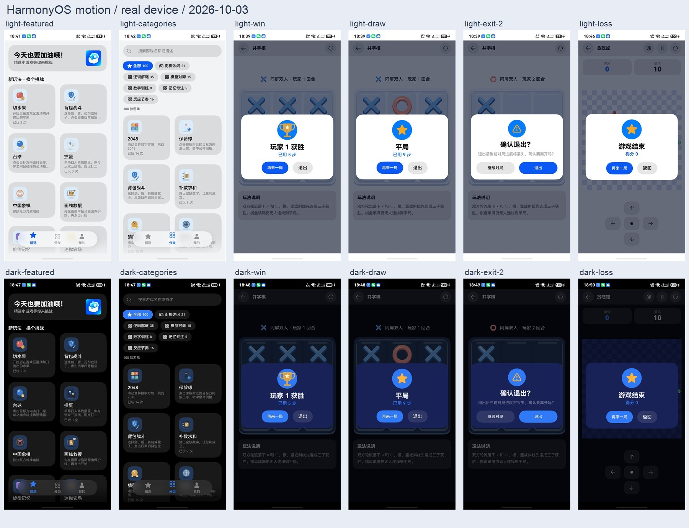

# 鸿蒙原生动效手机验证

2026-10-03，连接设备 ALN-AL00，HDC 目标 `FMR0224521016052`，竖屏截图 1260 × 2720。系统参数 `const.ohos.fullname` 返回 `OpenHarmony-7.0.0.105`；应用使用 DevEco Studio 的 API 24 SDK 构建。

本轮在实际手机上发现并修复了双击结算按钮后的触摸穿透：第一次点击立即删除浮层，第二次触摸落到新棋盘，使井字棋新局误落一子。公共结算与退出确认组件现在先以 140ms 退场，保留全屏触摸遮罩到 320ms 再执行一次回调，销毁时清理计时器。

## 包身份与证据

- 首轮包 SHA-256：`91e984ab218f9330dc22de107fd9f9055b544c73420e7e17677fc1b8def8c06a`。首轮截图与动作日志保留在本目录，[误落子截图](double-restart-diagnostic.jpeg)对应这一版本。
- 修复后包 SHA-256：`f6ca73771e0f35f35bd786801672b2b75e92b8da2a3089e90e9de120efc4def5`。签名包覆盖安装成功，未卸载或清除应用数据；最终复测证据全部位于 `final/`。
- 最终检查点：[summary.json](final/summary.json)；触摸及截图日志：[actions.jsonl](final/actions.jsonl)。每项证据记录本地构建包哈希，两个包阶段的结果不合并。

## 最终复测范围

每种主题执行 11 个公共交互检查，浅色与深色合计 **22/22 通过**，7 个阶段（含设置恢复）全部完成。全部操作通过 HDC 官方 `uitest` / `uinput` 输入，使用实际渲染布局定位控件，没有修改或注入游戏模型状态。

| 范围 | 检查行为 |
| --- | --- |
| 首页与分类 | 12 次连续切换 Tab 后内容正常；7 个分类的数量与选中描述正确；连续切换分类后显示全部 100 款，卡片宽度保持 552px |
| 原生卡片按压 | 按住有轻微收缩；移出松手后尺寸恢复；从卡片拖动只滚动列表，不误进游戏 |
| 我的页面 | 连续导航后排行榜内容可读 |
| 胜利结算 | 玩家 1 获胜，浮层正确遮挡底层重开；双击再来一局后棋盘为空、玩家 1 回合 |
| 其他结算 | 玩家 2 获胜、平局均正常显示和重开；贪吃蛇实际撞墙失败后显示结算 |
| 退出确认 | 连续打开并取消 3 次，最后一次双击取消，保留原有一枚棋子和玩家 2 回合；确认退出回到分类 |
| 方向键与暂停 | 按住方向键后移出松手恢复尺寸；暂停期间蛇的位置不变，继续后正常运动至结算，重开恢复可操作棋盘 |

按压目标参数是卡片 0.98、按钮 0.96。手机布局采样的宽度比约为卡片 0.991、方向键 0.984；这属于系统点击效果的观察值，不将采样值当作精确动画比例。没有通过放缩卡片布局尺寸实现按压。

最终浅色/深色的首页、分类、排行榜、胜利、平局、失败和退出确认截图用于视觉复核。浮层卡片保持不透明，文字、主次操作均可读。代表证据：[浅色胜利](final/light-win.jpeg)、[深色胜利](final/dark-win.jpeg)、[双击重开空棋盘](final/light-double-restart.jpeg)、[深色退出确认](final/dark-exit-2.jpeg)、[浅色失败重开](final/light-loss-restart.jpeg)。

## 构建、回归与恢复

修复后 API 24 `assembleHap` 成功；性能与设置回归 159/159，美术与反馈回归 7/7 通过。测试脚本早期曾因搜索条件残留、设备布局缺少纯 Symbol 按钮的可访问文本、重复触摸参数不被设备 CLI 接受而中断，已调整定位与输入方式后重跑。方向键取消检查改为按原位置定位同类无文本按钮，避免误匹配顶部按钮。蛇重开截图曾因输入/布局采样耗时而晚于再次撞墙，随后缩短开始到暂停之间的输入间隔并重跑，最终暂停及重开还断言不处于结算状态。

[安装信息](final/installed-bundle.txt)核对版本 1.0.0、目标 API 24 与本轮更新时间；[测试后诊断](final/diagnostics.json)确认应用进程仍运行。查询返回的最近故障记录为本轮之前的后台 `LowMemoryKill`，没有本轮期间的新记录；这个有界查询不作为完整性能测量。

测试结束将主题恢复为原来的「跟随系统」，并核对记住难度、触感反馈、退出确认三个开关与原值一致（false / true / true）。测试对局正常计入应用的已玩次数；未回滚统计。手机保留修复包并停在精选页。恢复证据见 [settings-restore.json](final/settings-restore.json) 与 [finished-home.jpeg](final/finished-home.jpeg)。

本轮针对本次修改的公共动效及代表游戏检查，没有逐款通关 100 个游戏，也没有复测平板、横屏或其他语言。动效截图按设备快照接口的实际速度采样，约数百毫秒一张，时间包含抓图开销；能复核进入/退出后的状态与外观，不能据此宣称稳定 60fps 或完整捕获 140ms 退场的每一帧。触感反馈的主观体验没有远程量测。

设计来源、API 核对与实现说明见[鸿蒙原生动效调研](../../harmony-native-motion-2026-10-03.md)。
