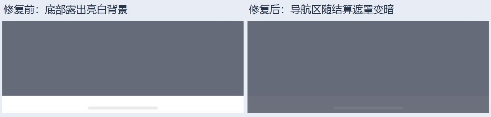

# 结算浮层底部系统导航区适配

2026-10-03，修复亮色主题结算遮罩与底部系统导航区割裂的问题。

## 修复

公共 `GameResultDialog` 的遮罩只覆盖应用安全区，底部系统导航区露出原本的亮白背景。给遮罩根组件添加 `expandSafeArea([SafeAreaType.SYSTEM], [SafeAreaEdge.BOTTOM])`，将遮罩的绘制延伸到底部系统安全区。`ExitConfirmDialog` 同步处理，保持公共浮层表现一致。复用已有双主题遮罩颜色，没有增加硬编码导航条高度或逐帧布局变更。

华为的[窗口沉浸式指南](https://developer.huawei.com/consumer/cn/doc/doccenter-capabilities/immersive-window-feature)支持通过组件安全区域能力进行绘制延伸；[官方蒙层示例](https://developer.huawei.com/consumer/cn/doc/doccenter-industry-solutions/appmask-0000002749819583)也用 `expandSafeArea` 覆盖系统栏区域，避免上下割裂。实际 SDK `ets/component/common.d.ts` 核对该属性自 API 10 支持。本次仅扩展底部遮罩，弹窗操作仍位于应用安全区内。

## 验证与包身份

- 修复前包 SHA-256：`f6ca73771e0f35f35bd786801672b2b75e92b8da2a3089e90e9de120efc4def5`；[原浅色结算截图](../harmony-motion-2026-10-03/final/light-win.jpeg)可看到底部亮白区域。
- 修复后签名包 SHA-256：`112246a3ba272f6f97588e312c009910b3f304c689feb84d0cf2cf495a33cf93`。已覆盖安装到 HDC 目标 `FMR0224521016052`，未卸载或清除数据。
- API 24 `assembleHap` 成功；性能与设置回归 159/159、美术与反馈回归 7/7 通过；`git diff --check` 通过。
- ALN-AL00 手机解锁后启动成功。浅色/深色的结算、遮罩阻挡、双击重开、玩家 2 胜利、平局、退出确认反复取消、失败结算与重开等相关交互 **12/12 通过**。使用实际触摸输入与渲染布局，没有注入游戏状态；[summary.json](summary.json)与[操作日志](actions.jsonl)记录本轮包身份及证据。
- [导航区像素检查](navigation-pixels.json)：10 张浮层截图（两种主题各胜利、玩家 2 胜利、平局、失败、退出确认）的导航区与上方背景最大单通道差均不超过 15；4 张关闭/返回截图恢复到修复前对应页面的正常背景色，差不超过 3。第一次恢复检查错误地假定分类页底部也是纯白，改为与原页面截图对照后通过。
- 测试后主题恢复为「跟随系统」，三个开关保持原值 false / true / true，见 [settings-restore.json](settings-restore.json)。修复包保留在手机上，停在[精选页](finished-home.jpeg)。

浅色胜利截图对照同一背景位置 `(100, 2610)` 与系统导航区位置 `(100, 2670)`：修复前 RGB 分别为 `(101,107,121)` / `(255,255,255)`，修复后为 `(101,107,121)` / `(108,112,124)`。底部亮白区域已随遮罩变暗，颜色与上方衔接。采样位置仅为当前 1260 × 2720 手机截图的验收证据，未写入应用逻辑。

修复前：[浅色结算](../harmony-motion-2026-10-03/final/light-win.jpeg)。修复后：[浅色结算](light-win.jpeg)、[浅色退出确认](light-exit-2.jpeg)。

本轮针对底部遮罩和相关浮层行为，验证范围为该手机竖屏；未切换三键导航或复测平板。本次修改没有切换全局窗口布局模式，也没有修改系统导航区高度。
