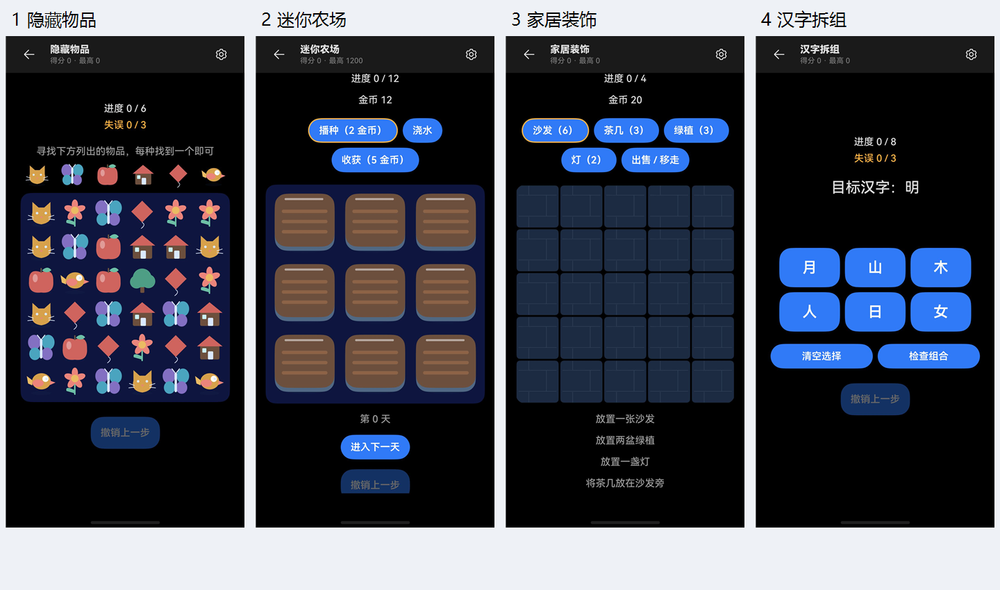

# 游戏去留审阅（2026-10-19）

本轮建议：优先撤下 10 款当前版本；另将 4 款数学练习合并到一个入口；10 款列入后续复审，其余 65 款暂不建议撤下。这里只给建议，未修改上架策略、路由、资源或用户数据。

**后续执行：** 用户随后明确要求撤下本报告列出的 10 款。2026-10-19 已将其加入撤下策略，当前开放 79 款，累计撤下 21 款；原模型、资源与旧战绩保留。数学入口合并尚未执行。下文保留审阅时的 89 款范围、探针与历史截图，不作为撤下后的当前包真机验收。

**原工作区验证：** 包含此前本地修复的完整工作区完成 26 套桌面回归 1330/1330 通过（包括保留的撤下游戏模型检查）；API 26 Debug 签名 HAP 构建成功。手机未连接，未安装或验证新包。数量、分类、包哈希及日志索引见[执行记录](game-retirement-review-2026-10-19/implementation/summary.json)，回归结果见[verification.json](game-retirement-review-2026-10-19/implementation/regressions/verification.json)。回归中补齐了接续测试对现有 FormKit 导入的模拟，并固定生命周期测试随机种子，避免合法的一步胜利局面破坏“对局尚未结束”的测试前提；未改动实际游戏规则。

**提交内容验证：** 排除此前本地修复和签名配置，将准备提交的源码与资源放入独立快照，25 套桌面检查 **1319/1319** 通过，见[提交快照回归记录](game-retirement-review-2026-10-19/implementation/commit-regressions/verification.json)。此数字与上面的完整工作区验证范围不同；未将原工作区安装包说成只包含本提交的产物。

## 范围与证据

- 产品定位按“面向普通用户、随手能玩的单人休闲合集”评估。没有用户留存、使用频率、评价或收益数据，因此不能断言某款游戏不受欢迎。
- 当前源码登记 100 款，`GameAvailability.ets` 排除已有的 11 款后开放 89 款。已撤下的井字棋、五子棋、黑白棋、四子连线、取石子、点格棋、拔河、斗地主、掼蛋、麻将、飞行棋不重复计入建议。
- 对 89 款目录与玩法说明进行初筛，重点阅读候选游戏模型和页面；复核相关历史真机截图。不是对 89 款逐一重新上手完成的真机验收。
- HDC 本轮返回 `[Empty]`，没有连接设备。画面来自 `device-acceptance/three-settlements-2026-10-14/` 的历史记录，涉及多个安装包；它们只支持所示历史状态，不能证明当前 API 26 包的手感、性能、音频或完整交互。
- 用现有桌面模型加载器做内容结构探针；不将模型结果称为真机结果。未改动产品代码，无需构建新包。

## 判定标准

优先精简：名称与实际内容落差明显、核心挑战能被固定捷径绕过、有限内容很快耗尽，以及相同答题流程被拆成多个游戏入口。

经典游戏的规则简单、单局短、画面朴素、通关困难，都不是单独撤下的理由。扫雷、2048、纸牌、记忆翻牌等即使规则固定，仍有不同局面和决策。源码共用文件也不等于玩法重复。

下表“撤下”指先隐藏当前版本的产品入口并保留代码与旧战绩；不是永久放弃这个玩法类型。

## 优先撤下的 10 款

| 顺序 | 游戏 / ID | 核实到的事实 | 产品判断及恢复条件 |
| --- | --- | --- | --- |
| 1 | 隐藏物品 / `hiddenobjects` | 6×6 网格使用 9 种规则摆放的图标，找齐 6 类即可；生成器还把 6 个目标依次放在主对角线。三档难度、每档 30 个种子，按 0、7、14、21、28、35 点击，90/90 模型局直接获胜。 | 寻物过程可以完全绕过；画面也缺少场景藏物的观察层次。建议撤下，做成真正的场景寻物后恢复；只去掉对角线捷径还不足以解决内容单薄。 |
| 2 | 迷你农场 / `farm` | 9 块地、单一作物，播种花 2 金币、浇水、手动进入下一天、收获赚 5 金币，累计收获 12 次即结束。三档开局、目标与经济参数相同。 | 主要是重复操作，没有作物选择、订单或经营路线；不够支撑独立的农场游戏。补充有取舍的种植目标和持续内容后恢复。 |
| 3 | 家居装饰 / `decorate` | 固定 5×5 房间、20 金币、4 类家具；固定要求沙发、两盆绿植、灯和沙发旁的茶几，完成即结算。三档目标相同。 | 更接近一次性的摆放教学关。缺少房型、主题或作品保留，装饰的表达空间有限。至少增加不同房型目标或可保留的自由布置后恢复。 |
| 4 | 汉字拆组 / `characters` | 仅 8 个固定配方：明、林、休、好、男、炎、森、品；每局 8 题，难度只改变这 8 个配方的起始位置，选项顺序随机。 | 一局就覆盖核心题库，重玩主要依靠记住答案；目前更适合并入文字练习。扩大经过校对的内容与组合层次后再独立上架。 |
| 5 | 成语填字 / `idiom` | 总题库 16 条，每局 8 题，抽取顺序随机；普通、困难改变空缺位置，干扰选项从字表抽取。 | 内容量很快见底，缺少释义和内容进阶。建议并入文字练习或先撤下；题库显著扩充并有解释后恢复。不是因为它是学习类玩法而撤下。 |
| 6 | 文字合成塔防 / `wordtower` | 木、火、水、金费用相同；基本塔伤害均为 1、合成后均为 3，攻击间隔均为 0.6 秒；没有按文字种类区分攻击效果。 | 文字选择对战斗效果没有差异，文字合成更多是主题包装；与已有房间塔防相比，独立价值不足。增加有意义的字塔差异、组合路线后恢复。 |
| 7 | 背包战斗 / `backpack` | 仅 4 类固定装备，固定费用与形状；五轮敌人的血量、伤害按固定公式计算，点击战斗立即结算；没有本局随机商店或装备获取选择。 | 有装箱空间取舍，但缺少持续改变构筑的内容，理解公式后容易变成重复解同一道题。增加随机供给、装备差异及可读战斗反馈后恢复。 |
| 8 | 找不同 / `differences` | 两幅 5×5 图标网格，从 6 类物品中生成；随机选择 3/4/5 格，把右图对应图标替换为下一种。历史截图两幅图各占半屏。 | 有观察玩法，但与用户常见的场景找不同存在明显落差；小图标密集对照的表现也偏弱。建议等有真正场景图、差异设计及放大查看后恢复。 |
| 9 | 一笔画 / `onestroke` | 每档难度只定义一张固定的 3×3 节点图，分别为 10/13/16 条边；随机的是内部求解路径，显示给用户的图不变。每档 10 个种子均得到相同图。 | 不是一笔画本身不适合，而是当前只有 3 张题面，记住路线后内容耗尽。加入足量关卡或不同拓扑的可解图生成后恢复。 |
| 10 | 迷你高尔夫 / `golf` | 固定起点、球洞和两块挡板，20 杆上限；三档难度、10 个种子下的开局布局与规则参数相同。 | 球的运动有操作空间，但只有一个固定球洞，且难度没有实质变化。优先把维护投入给关卡更完整的玩法；有多球洞路线与目标后恢复。 |

相关实现：

- [隐藏物品、一笔画、成语、文字塔防模型](../entry/src/main/ets/model/game/ExpansionBrain.ets)
- [隐藏物品页面](../entry/src/main/ets/pages/collection/ExpansionBrainBoard.ets)
- [农场与装饰模型](../entry/src/main/ets/model/game/ExpansionLife.ets)
- [汉字配方与出题](../entry/src/main/ets/model/game/ExpansionTable.ets)
- [背包布局与战斗公式](../entry/src/main/ets/model/game/ExpansionAction.ets)
- [找不同生成逻辑](../entry/src/main/ets/model/game/ExpansionAdventure.ets)
- [找不同页面](../entry/src/main/ets/pages/collection/ExpansionPage.ets)
- [高尔夫布局与规则](../entry/src/main/ets/model/game/ExpansionSports.ets)

## 建议合并的 4 个独立入口

将算式比大小 `compare`、数列推演 `sequence`、二进制解码 `binary`、补数求和 `targetsum`，与心算十题 `arithmetic` 合为“数学挑战”的五种模式。

它们的题型不同，但当前都是十题选择、答对计分、结束结算。数列只有等差以及困难中的翻倍，二进制为基础转换，补数为两项已知加数求第三项。保留题型，集中一个入口更容易理解，也减少目录中相似卡片。

这属于目录组织建议，不应在尚未提供模式入口时直接隐藏四款并导致内容消失。若仅先撤下上表 10 款，开放数量是 79；数学模式合并完成后，按独立入口计数为 75。

实现依据：[CollectionModel.question / 十题计分流程](../entry/src/main/ets/model/game/CollectionModel.ets)。

## 暂缓撤下、需要后续复审的 10 款

| 游戏 / ID | 当前问题 | 为什么不直接列入首批撤下 |
| --- | --- | --- |
| 保龄球 / `bowling` | 三次投球、固定瓶阵，击中后按邻近距离消除球瓶；不是完整的瓶间碰撞连锁。 | 仍有明确的瞄准挑战。先评估手感和命中反馈；若不增强，适合下一批精简。 |
| 乒乓球 / `pingpong` | 当前是上下两条挡板反弹小球，更符合 Pong，现名容易造成期待落差。 | 可改名“挡板对战”保留，未必需要删除；与空气曲棍球的运动和判定有区别。 |
| 节奏落键 / `rhythm` | 随机四轨序列、固定间隔生成音符，没有看到歌曲谱面驱动；不能据截图评价声音和时序手感。 | 先明确它要做音乐游戏还是反应挑战。普通按键音效不等于歌曲同步，也不能断言它完全无声。 |
| 节拍跳跃 / `beatjump` | 随机方向、固定节拍与三个按钮，与节奏落键在定时按键上重叠。 | 可选择两者之一集中打磨；此次没有当前包音画与触控实测，不宜仅凭名称决定保留哪款。 |
| 坦克对战 / `tanks` | 与生存玩法共用拖动、自动瞄准和追击，但坦克敌人会发射炮弹。 | 不能把它说成纯换皮；先比较躲弹手感，再决定保留哪个方向。 |
| 自动攻击生存 / `survival` | 以走位自动攻击为主，没有看到升级选择和成长构筑。 | 基础走位仍可能有乐趣，需与坦克对战实玩比较；若后续不做成长，可考虑合并或择一。 |
| 爬坡越野 / `hillclimb` | 固定正弦地形，三档主要改变目标距离；没有车体翻转或车辆选择。 | 油门、刹车与落地有操作因素，是否好玩需要实际手感，暂不据简化物理判死刑。 |
| 横版跳跃闯关 / `platformer` | 平台按固定间距和高度循环铺设，难度主要延长路线。 | 横版跳跃是可发展的方向，先补差异关卡；不因同样有跳跃而与跳一跳混为一谈。 |
| 滚动球闯关 / `rollingball` | 固定三块挡板，难度增加洞口，题面变化不足。 | 有惯性与避障的独立操作，先补关卡，再决定是否值得持续维护。 |
| 图片拼图 / `picturepuzzle` | 目前引用一张固定场景图，不同难度改变分块数。 | 可通过增加图片解决，交换拼图与滑动数字拼图规则不同，不应仅凭名字相近直接合并。 |

## 应当保留的方向

贪吃蛇、俄罗斯方块、2048、扫雷、数独、消消乐、打砖块、滑动拼图、华容道、猜数字、记忆翻牌，以及有明确不同局面的排序、消除和益智玩法，应继续作为主体打磨。它们虽有经典规则，但重玩时仍存在不同局面或操作挑战。

经典纸牌、蜘蛛纸牌、空当接龙不因验收耗时、历史结算数量不足或曾有已修复显示问题而撤下。中国象棋和国际象棋目前为人机对战，不属于已撤下的同屏双人玩法；没有足够新证据建议仅因“属于棋类”就撤下。

“暂不建议撤下”只代表本轮没有充分的精简理由，不代表已经完成当前包的质量验收。

## 历史画面的三个观察步骤

1. **目录与搜索——范围可核对。** 历史截图展示 89 款目录及候选游戏卡片；当前源码重新验证了相同开放数量。未实测本轮安装包的搜索和导航。
2. **开局与主要画面——候选问题明显。** 农场、装饰为固定格子任务；隐藏物品、找不同为图标网格；文字塔防仅有六个固定塔位。来源画面可用，但触控与音频不在截图证明范围内。
3. **结算与再玩——内容变化不足。** 历史截图有结果弹窗，当前源码和探针确认若干游戏再开仍是相同题面或目标。结果弹窗只证明历史状态，不证明有趣、胜利覆盖完整或本轮新包已验证。

以下是本轮重新查看的历史画面汇总，顺序为隐藏物品、迷你农场、家居装饰、汉字拆组；只裁去系统状态栏并等比例排版，没有修改游戏内容：

更多已查看画面：

- [找不同与成语](game-retirement-review-2026-10-19/history/sheet-differences-idiom.jpeg)
- [背包战斗与农场](game-retirement-review-2026-10-19/history/sheet-backpack-farm.jpeg)
- [文字合成塔防](game-retirement-review-2026-10-19/history/sheet-wordtower.jpeg)
- [一笔画](game-retirement-review-2026-10-19/history/sheet-onestroke.jpeg)
- [迷你高尔夫](game-retirement-review-2026-10-19/history/sheet-golf.jpeg)
- [保龄球](game-retirement-review-2026-10-19/history/sheet-bowling.jpeg)
- [乒乓球](game-retirement-review-2026-10-19/history/sheet-pingpong.jpeg)
- [节拍跳跃](game-retirement-review-2026-10-19/history/sheet-beatjump.jpeg)
- [算式比较与数列](game-retirement-review-2026-10-19/history/sheet-compare-sequence.jpeg)
- [二进制与补数](game-retirement-review-2026-10-19/history/sheet-binary-targetsum.jpeg)

可见的可访问性风险：找不同两块半屏图标网格的目标较密集，需要在真机上测量命中区域并检查放大能力；深色图形在部分画面上分辨度偏低，应测量实际颜色对比度。此次没有验证屏幕朗读、字体放大、触控误点率或颜色辨识，不能据截图宣布这些项目失败。

## 内容结构探针

使用现有 `scripts/test-performance.cjs` 的 `fixture()` 和 `ExpansionModel`，没有注入手机状态。

- `farm`、`decorate`、`golf`、`backpack`：每档各测 10 个随机种子，投影到棋盘、目标、经济数据和物件初始几何后，每档都只有 1 种开局；固定同一个种子比较三档，内容投影也只有 1 种。此投影不包含 `level` 标签等元数据，不能据此说全部状态逐字段相同。
- `onestroke`：同一难度的 10 个种子都是同一组边，三档合计 3 张不同的图；求解路径允许变化，题面没有变。
- `hiddenobjects`：三档各 30 个种子，固定点击主对角线六格，90/90 模型局获胜。源码明确给每个对角格写入一个目标，结论不只来自抽样。
- `characters` 配方 8 条、`idiom` 总题库 16 条，均从当前导出常量核对。
- `picturepuzzle` 有随机打乱，`rollingball`、`platformer`、`hillclimb` 的三档有规则或几何区别，未将这些说成三档完全相同。

## 执行建议

先落实 10 款当前版本的入口撤下，保留原代码、资源与旧战绩；再单独完成数学模式入口合并。其他 10 款先做实玩比较和内容改进，再决定第二批名单。不要为凑一个整数数量继续削减，也不要把此次建议当作发布合规判断。

## 89 款初筛清单

以下为目录层面的去留初筛，不能当作逐款真机通过清单。

| 序号 | 游戏 | ID | 本轮建议 |
| --- | --- | --- | --- |
| 1 | 贪吃蛇 | `snake` | 暂不建议撤下 |
| 2 | 俄罗斯方块 | `tetris` | 暂不建议撤下 |
| 3 | 2048 | `2048` | 暂不建议撤下 |
| 4 | 打地鼠 | `whackmole` | 暂不建议撤下 |
| 5 | 扫雷 | `minesweeper` | 暂不建议撤下 |
| 6 | 数独 | `sudoku` | 暂不建议撤下 |
| 7 | 滑动拼图 | `slidepuzzle` | 暂不建议撤下 |
| 8 | 华容道 | `klotski` | 暂不建议撤下 |
| 9 | 猜数字 | `guessnumber` | 暂不建议撤下 |
| 10 | 记忆翻牌 | `memorycard` | 暂不建议撤下 |
| 11 | 跳一跳 | `jumpjump` | 暂不建议撤下 |
| 12 | 打砖块 | `brickbreaker` | 暂不建议撤下 |
| 13 | 消消乐 | `match3` | 暂不建议撤下 |
| 14 | 十字熄灯 | `lights` | 暂不建议撤下 |
| 15 | 色块归一 | `flood` | 暂不建议撤下 |
| 16 | 迷宫寻路 | `maze` | 暂不建议撤下 |
| 17 | 汉诺塔 | `hanoi` | 暂不建议撤下 |
| 18 | 跳子独留 | `peg` | 暂不建议撤下 |
| 19 | 数字绘格 | `nonogram` | 暂不建议撤下 |
| 20 | 心算十题 | `arithmetic` | 暂不建议撤下 |
| 21 | 算式比大小 | `compare` | 建议合并为数学挑战模式 |
| 22 | 数列推演 | `sequence` | 建议合并为数学挑战模式 |
| 23 | 二进制解码 | `binary` | 建议合并为数学挑战模式 |
| 24 | 补数求和 | `targetsum` | 建议合并为数学挑战模式 |
| 25 | 数字寻序 | `schulte` | 暂不建议撤下 |
| 26 | 顺序记忆 | `memorysequence` | 暂不建议撤下 |
| 27 | 记忆缺项 | `missing` | 暂不建议撤下 |
| 28 | 信号反应 | `reaction` | 暂不建议撤下 |
| 29 | 方块拼填 | `blockfit` | 暂不建议撤下 |
| 30 | 堆叠三消 | `tilestack` | 暂不建议撤下 |
| 31 | 泡泡龙 | `bubbleshooter` | 暂不建议撤下 |
| 32 | 落果合成 | `fruitmerge` | 暂不建议撤下 |
| 33 | 倒水排序 | `watersort` | 暂不建议撤下 |
| 34 | 箭头清除 | `arrowclear` | 暂不建议撤下 |
| 35 | 拆螺丝 | `screwout` | 暂不建议撤下 |
| 36 | 停车场挪车 | `parkingjam` | 暂不建议撤下 |
| 37 | 无尽跑酷 | `runner` | 暂不建议撤下 |
| 38 | 黑洞吞噬 | `blackhole` | 暂不建议撤下 |
| 39 | 大鱼吃小鱼 | `fisheat` | 暂不建议撤下 |
| 40 | 推箱子 | `sokoban` | 暂不建议撤下 |
| 41 | 管道连通 | `pipes` | 暂不建议撤下 |
| 42 | 找不同 | `differences` | 建议先撤下当前版本 |
| 43 | 房间塔防 | `roomdefense` | 暂不建议撤下 |
| 44 | 篮球投篮 | `basketball` | 暂不建议撤下 |
| 45 | 经典纸牌 | `solitaire` | 暂不建议撤下 |
| 46 | 汉字拆组 | `characters` | 建议先撤下当前版本 |
| 47 | 节奏落键 | `rhythm` | 暂缓撤下，后续复审 |
| 48 | 迷你餐厅 | `restaurant` | 暂不建议撤下 |
| 49 | 连连看 | `linktiles` | 暂不建议撤下 |
| 50 | 麻将接龙 | `mahjongsolitaire` | 暂不建议撤下 |
| 51 | 点击群消 | `groupclear` | 暂不建议撤下 |
| 52 | 落槽配对消除 | `slotpair` | 暂不建议撤下 |
| 53 | 乘客上车 | `buscolor` | 暂不建议撤下 |
| 54 | 毛线收卷 | `yarn` | 暂不建议撤下 |
| 55 | 沙画吸色 | `sand` | 暂不建议撤下 |
| 56 | 绳结解开 | `untangle` | 暂不建议撤下 |
| 57 | 横版跳跃闯关 | `platformer` | 暂缓撤下，后续复审 |
| 58 | 钩索摆荡 | `grapple` | 暂不建议撤下 |
| 59 | 飞行穿柱 | `flappy` | 暂不建议撤下 |
| 60 | 切水果 | `fruitslice` | 暂不建议撤下 |
| 61 | 滚动球闯关 | `rollingball` | 暂缓撤下，后续复审 |
| 62 | 雷电战机 | `shooter` | 暂不建议撤下 |
| 63 | 坦克对战 | `tanks` | 暂缓撤下，后续复审 |
| 64 | 射击守城 | `fortress` | 暂不建议撤下 |
| 65 | 自动攻击生存 | `survival` | 暂缓撤下，后续复审 |
| 66 | 背包战斗 | `backpack` | 建议先撤下当前版本 |
| 67 | 台球 | `billiards` | 暂不建议撤下 |
| 68 | 足球点球 | `penalty` | 暂不建议撤下 |
| 69 | 乒乓球 | `pingpong` | 暂缓撤下，后续复审 |
| 70 | 保龄球 | `bowling` | 暂缓撤下，后续复审 |
| 71 | 迷你高尔夫 | `golf` | 建议先撤下当前版本 |
| 72 | 单键漂移 | `drift` | 暂不建议撤下 |
| 73 | 爬坡越野 | `hillclimb` | 暂缓撤下，后续复审 |
| 74 | 空气曲棍球 | `airhockey` | 暂不建议撤下 |
| 75 | 中国象棋 | `xiangqi` | 暂不建议撤下 |
| 76 | 国际象棋 | `chess` | 暂不建议撤下 |
| 77 | 蜘蛛纸牌 | `spider` | 暂不建议撤下 |
| 78 | 空当接龙 | `freecell` | 暂不建议撤下 |
| 79 | 一笔画 | `onestroke` | 建议先撤下当前版本 |
| 80 | 隐藏物品 | `hiddenobjects` | 建议先撤下当前版本 |
| 81 | 画线救援 | `linerescue` | 暂不建议撤下 |
| 82 | 图片拼图 | `picturepuzzle` | 暂缓撤下，后续复审 |
| 83 | 成语填字 | `idiom` | 建议先撤下当前版本 |
| 84 | 文字合成塔防 | `wordtower` | 建议先撤下当前版本 |
| 85 | 节拍跳跃 | `beatjump` | 暂缓撤下，后续复审 |
| 86 | 旋律记忆 | `melody` | 暂不建议撤下 |
| 87 | 迷你农场 | `farm` | 建议先撤下当前版本 |
| 88 | 家居装饰 | `decorate` | 建议先撤下当前版本 |
| 89 | 休闲钓鱼 | `fishing` | 暂不建议撤下 |
