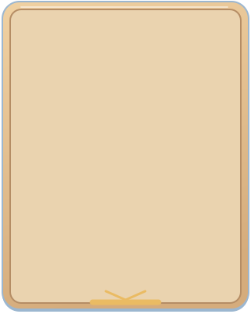

# 13 款游戏对局美术

对局素材位于 `entry/src/main/resources/base/media/play_*` 与 `dark/media/play_*`，已接入 13 个游戏页面。2026-10-08已按当前入口图标重绘为统一的柔和玩具矢量风格，46个资源名均有深浅版本；角色也使用SVG。运行 `node scripts/generate-gameplay-art.mjs` 可重建素材和对应游戏配色。

| 游戏 | 对局素材 |
| --- | --- |
| 贪吃蛇 | 蛇头、食物 |
| 俄罗斯方块 | 方块高光 |
| 2048 | 数字方块表面 |
| 打地鼠 | 地洞、鼹鼠角色 |
| 扫雷 | 地雷、旗帜 |
| 数独 | 棋盘格装饰 |
| 滑动拼图 | 拼图块表面 |
| 华容道 | 木质棋盘、曹操、横将、竖将、小兵 |
| 猜数字 | 数字键表面 |
| 记忆翻牌 | 卡背、12 种原创配对图案 |
| 跳一跳 | 青蛙角色、平台 |
| 打砖块 | 砖块、挡板、弹球 |
| 消消乐 | 6 种宝石 |

## 华容道预览

   

## 其他素材预览

   

图标、原13款及另外20款合集对局资源共用 `scripts/game-art-palette.cjs` 的纸色、mint、珊瑚、金色、木色和蓝灰边缘。数字、计分与操作文字仍由ArkUI绘制，选中、归位、揭开等状态继续使用明确的底色和文字，玩法与碰撞算法保持。

新增低对比度场景用于跳一跳、打地鼠和打砖块，装饰不接收输入。蛇头/体/弯/尾保留连接方向并改为平滑轮廓；华容道木块在深色使用浅字、浅彩色块使用深墨字。旧鼹鼠PNG保存在 `docs/art/legacy-gameplay/`，应用资源中移除同名PNG以避免重复资源。

本轮[交付与验证](art/legacy-gameplay-2026-10-08/README.md)、[浅色对照](art/legacy-gameplay-2026-10-08/base.png)、[深色对照](art/legacy-gameplay-2026-10-08/dark.png)。对照图是素材组合预览，不是设备截图。
